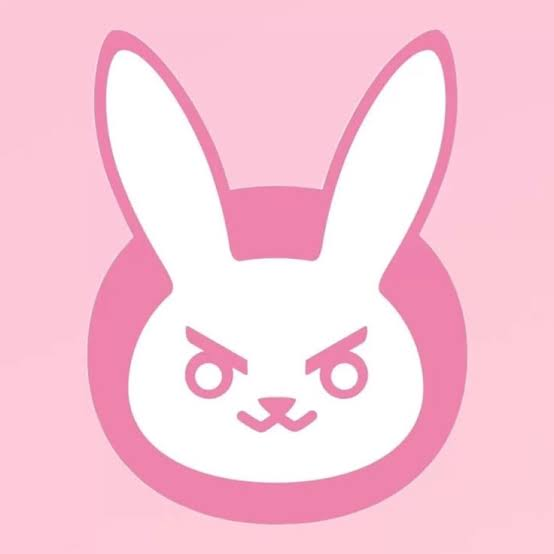

<!-- ✿ Player 2 profile ✿ -->
<p align="center">
  
</p>

<p align="center">
  
</p>

<p align="center">
  
</p>

<p align="center">
  
  
  
</p>

---

###  ┊ about me

```cpp
struct Bastav {
    std::string role     = "student dev ✿";
    int         age      = 18;
    std::string mains[2] = {"Python 🐍", "C++ ⚡"};
    std::string vibe     = "anime + gaming 🎮";
    std::string goal     = "build cute, fast little things ♡";
    int         hp       = 9999;  // never rage quits
};
```

- 💗 &nbsp;currently grinding **Python** and **C++**
- 🎮 &nbsp;powered by snacks, anime OSTs and late-night ranked games
- 🌸 &nbsp;learning in public, one tiny bug at a time
- ✨ &nbsp;ask me about: beginner Python, C++ basics, cool anime recs

### ⚡ ┊ loadout

<p align="center">
  
  
  
  
  
</p>

### 🎮 ┊ player stats

<p align="center">
  
  
</p>

<p align="center">
  
</p>

---

<p align="center">
  <br/>
  <b>thanks for visiting ♡ (｡•ᴗ•｡)ﾉ</b><br/>
  <sub>またね ✿ GG, see you next match 🎮</sub>
</p>

<p align="center">
  
</p>
